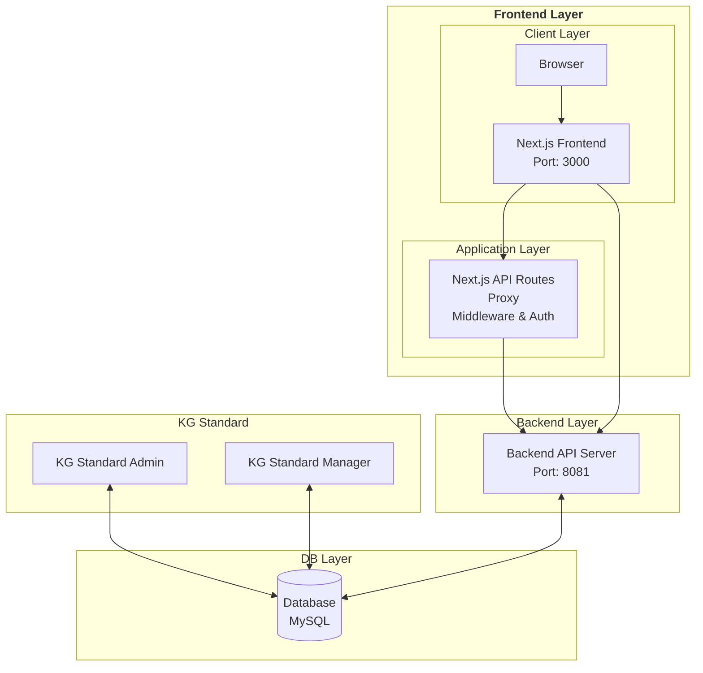

# 🏛️ KG Standard User Web

<div align="center">


**KG Standard User Web**은 Firzzle 웹 애플리케이션 솔루션 기반 Next.js 라이브러리를 활용한 Front Office Client Side 웹 애플리케이션 입니다.

[🚀 시작하기](#-시작하기) • [📋 기능](#-주요-기능) • [🏗️ 아키텍처](#️-아키텍처) • [🔧 개발](#-개발)

</div>

---

## 📋 주요 기능

### 🎯 핵심 기능
- **🔐 JWT 기반 인증 시스템** - 안전한 사용자 인증 및 토큰 관리
- **📊 실시간 시스템 상태 모니터링** - API 서버 및 데이터베이스 상태 확인
- **🌍 다중 환경 지원** - 로컬, 개발, 운영 환경별 설정
- **📱 반응형 UI** - 모든 디바이스에서 최적화된 사용자 경험
- **⚡ 고성능** - Next.js 15 + Turbopack으로 빠른 개발 및 빌드

### 🛠️ 기술적 특징
- **3-Tier 아키텍처** - 프론트엔드, Next.js API, 백엔드 서버
- **컴포넌트 기반 설계** - 재사용 가능한 UI 컴포넌트
- **상태 관리** - React Context API를 통한 전역 상태 관리
- **타입 안전성** - TypeScript로 강타입 개발
- **테스트 자동화** - Playwright를 통한 E2E 테스트

---

## 🏗️ 아키텍처



### 📁 프로젝트 구조

```
📦 kg-standard-user-web/
├── 📁 app/                          # Next.js App Router
│   ├── 📁 (apis)/                   # API 라우트 그룹
│   │   └── 📁 api/health-check/     # 헬스체크 API
│   ├── 📁 (pages)/                  # 페이지 그룹
│   │   ├── 📁 main/                 # 메인 페이지
│   │   │   ├── 📁 components/       # 페이지별 컴포넌트
│   │   │   ├── 📁 contexts/         # React Context
│   │   │   └── 📄 page.tsx          # 메인 페이지
│   │   └── 📁 health-check/         # 헬스체크 페이지
│   ├── 📄 layout.tsx                # 루트 레이아웃
│   └── 📄 page.tsx                  # 홈페이지
├── 📁 components/                   # 공통 UI 컴포넌트
│   └── 📁 ui/                       # Radix UI 컴포넌트
├── 📁 lib/                          # 유틸리티 및 매니저
│   ├── 📁 manager/                  # API 클라이언트 매니저
│   └── 📁 utils/                    # 유틸리티 함수
├── 📁 store/                        # 전역 State (zustand)
├── 📁 services/                     # 서비스 레이어
├── 📁 constants/                    # 상수 정의
├── 📁 styles/                       # 스타일시트
├── 📁 tests/                        # 테스트 파일
└── 📄 middleware.ts                 # Next.js 미들웨어
```

---

## 🚀 시작하기

### 📋 사전 요구사항

- **Node.js** 20.x 이상
- **pnpm** (권장) 또는 npm
- **Docker** (선택사항)

### 🔧 설치 및 실행

#### 1️⃣ 저장소 클론
```bash
git clone <repository-url>
cd kg-standard-user-web
```

#### 2️⃣ 의존성 설치
```bash
# pnpm 사용 (권장)
pnpm install

# 또는 npm 사용
npm install
```

#### 3️⃣ 환경 변수 설정
```bash
# .env.local 없을 시 파일 생성
cp .env.example .env.local

# 환경 변수 설정
NEXT_PUBLIC_API_FRONT_BASE_URL=http://localhost:3000
NEXT_PUBLIC_API_BACK_BASE_URL=http://localhost:8081
...
```

#### 4️⃣ 개발 서버 실행
```bash
# 개발 서버 시작 (Turbopack 사용)
pnpm dev

# 또는 npm 사용
npm run dev
```

#### 5️⃣ 브라우저에서 확인
```
🌐 http://localhost:3000
```

---

## 🛠️ 개발

### 📜 사용 가능한 스크립트

```bash
# 개발 서버 실행 (Turbopack)
pnpm dev

# 프로덕션 빌드
pnpm build

# 프로덕션 서버 실행
pnpm start

# 린트 검사
pnpm lint

# 디버깅 린트
pnpm lint:debug

# 에러만 표시하는 린트
pnpm lint:errors-only

# E2E 테스트 실행
pnpm test

# 테스트 UI 모드
pnpm test:watch

# 테스트 커버리지
pnpm test:coverage
```

### 🐳 Docker 사용

#### 이미지 빌드
```bash
# 개발 환경
docker build --build-arg PROFILES_ACTIVE=development -t kg-standard-user-web .

# 운영 환경
docker build --build-arg PROFILES_ACTIVE=production -t kg-standard-user-web .
```

#### 컨테이너 실행
```bash
# 개발 환경
docker run -d -p 3000:3000 --restart=always --name kg-standard-user-web kg-standard-user-web

# 운영 환경
docker run -d -p 3001:3000 --restart=always --name kg-standard-user-web kg-standard-user-web
```

---

## 🎨 기술 스택

### 🖥️ Frontend
- **Next.js 15.5.3** - React 프레임워크
- **React 19.1.0** - UI 라이브러리
- **TypeScript 5.0** - 타입 안전성
- **Tailwind CSS 4.0** - 스타일링
- **Radix UI** - 접근성 우선 컴포넌트
- **Lucide React** - 아이콘 라이브러리

### 🔧 개발 도구
- **Turbopack** - 빠른 번들링
- **ESLint** - 코드 품질 관리
- **Playwright** - E2E 테스트
- **pnpm** - 패키지 매니저

### 🏗️ 아키텍처
- **App Router**   - Next.js 13+ 라우팅
- **Middleware**   - 인증 및 라우트 보호
- **zustand**      - 전역 상태 관리
- **Custom Hooks** - 로직 재사용

---

## 🌍 환경 설정

### 🔧 환경별 설정

| 환경 | 프론트엔드                        | API 서버 | 데이터베이스 |
|------|------------------------------|----------|--------------|
| **로컬** | `localhost:3000`             | `localhost:8081` | 로컬 DB |
| **개발** | `dev-frontend.firzzle.co.kr` | `dev-st-api.firzzle.co.kr:8443` | 개발 DB |
| **운영** | `st-frontend.firzzle.co.kr`  | `st-api.firzzle.co.kr` | 운영 DB |

### 🔐 인증 시스템

- **JWT 토큰** 기반 인증
- **자동 토큰 갱신** 기능
- **중복 로그인 방지**
- **라우트 보호** 미들웨어

---

## 📊 성능 최적화

### ⚡ 최적화 기능
- **Turbopack** - 초고속 번들링
- **Standalone 빌드** - 컨테이너 최적화
- **이미지 최적화** - Next.js Image 컴포넌트
- **코드 스플리팅** - 자동 청크 분할
- **캐싱 전략** - API 응답 캐싱

### 📈 모니터링
- **실시간 시스템 상태** 확인
- **API 응답 시간** 측정
- **환경별 헬스체크** 자동화
- **에러 추적** 및 로깅

---

## 🧪 테스트

### 🔍 테스트 전략
- **E2E 테스트** - Playwright
- **컴포넌트 테스트** - React Testing Library
- **API 테스트** - 헬스체크 엔드포인트
- **인증 테스트** - 로그인 플로우

### 🚀 테스트 실행
```bash
# 모든 테스트 실행
pnpm test

# 테스트 UI 모드
pnpm test:watch

# 특정 테스트 실행
pnpm test tests/auth/login.spec.ts
```

---

## 📝 개발 가이드

### 🎯 코딩 컨벤션
- **TypeScript** 강타입 사용
- **ESLint** 규칙 준수
- **컴포넌트 분리** 원칙
- **재사용 가능한** 코드 작성

### 📁 파일 구조 규칙
```
📁 components/          # 공통 컴포넌트
📁 app/(pages)/         # 페이지별 컴포넌트
📁 contexts/           # React Context
📁 hooks/              # Custom Hooks
📁 services/           # API 서비스
📁 lib/                # 유틸리티
```

### 🔄 Git 워크플로우
```bash
# 기능 브랜치 생성
git checkout -b feature/new-feature

# 커밋 및 푸시
git add .
git commit -m "feat: 새로운 기능 추가"
git push origin feature/new-feature

# develop 브랜치로 머지
git checkout develop
git merge feature/new-feature
```

---

## 🚀 배포

### 🐳 Docker 배포
```bash
# 운영 환경 이미지 빌드
docker build --build-arg PROFILES_ACTIVE=production -t kg-standard-user-web:latest .

# 컨테이너 실행
docker run -d -p 3001:3000 --restart=always --name kg-standard-user-web kg-standard-user-web:latest
```

### ☁️ 클라우드 배포
- **Vercel** - Next.js 최적화 배포
- **Docker Hub** - 컨테이너 이미지 저장
- **CI/CD** - 자동 배포 파이프라인

---

## 🤝 기여하기

### 📋 기여 가이드
1. **Fork** 저장소
2. **기능 브랜치** 생성 (`git checkout -b feature/amazing-feature`)
3. **커밋** 변경사항 (`git commit -m 'Add amazing feature'`)
4. **푸시** 브랜치 (`git push origin feature/amazing-feature`)
5. **Pull Request** 생성

### 🐛 버그 리포트
- **이슈 템플릿** 사용
- **재현 단계** 상세 기록
- **환경 정보** 포함
- **스크린샷** 첨부

---

## 📄 라이선스

이 프로젝트는 **MIT 라이선스** 하에 배포됩니다. 자세한 내용은 [LICENSE](LICENSE) 파일을 참조하세요.

---


## 🔗 관련 링크
- [Next.js 문서](https://nextjs.org/docs)
- [React 문서](https://react.dev)
- [TypeScript 문서](https://www.typescriptlang.org/docs)
- [Tailwind CSS 문서](https://tailwindcss.com/docs)

---

<div align="center">

**KG Standard User Web** - LMS 웹 애플리케이션

Made with by KG Team

[⬆️ 맨 위로](#-kg-standard-user-web)

</div>